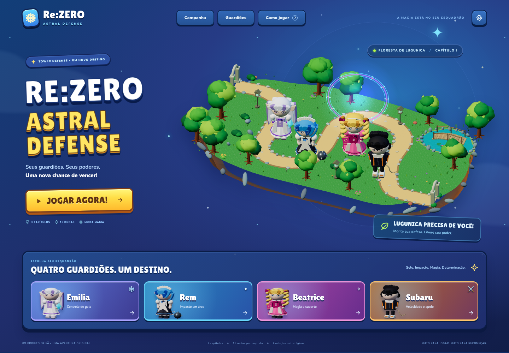

# Re:Zero — Astral Defense

Tower defense 3D para navegador, com quatro guardiões, três capítulos e partidas de 15 ondas. Esta reconstrução implementa a Etapa 1 e estabiliza a base para as próximas expansões.



## Jogar e desenvolver

Requer Node.js 20.11 ou superior. Não há dependências de instalação para executar o jogo.

```sh
npm run dev
```

Abra `http://127.0.0.1:5173`. O jogo usa módulos ES; sirva os arquivos por HTTP em vez de abrir `index.html` pelo protocolo `file:`.

- Escolha um capítulo, selecione um guardião e clique/toque em um terreno livre.
- Toque em um guardião posicionado para evoluir ou vender. **Ver todas as evoluções** abre os três caminhos com seus 15 níveis, preços, efeitos e comparação de sete atributos. No celular, funciona em retrato e paisagem.
- No menu, abra um guardião e escolha **Ver todas as evoluções** para explorar o catálogo sem gastar moedas.
- A base tem **25 pontos de defesa**. Comuns retiram 1, blindados 2 e chefes 5; a partida acaba em zero. Toque no indicador **DEFESA 25/25** para consultar quantos de cada tipo ainda precisam atravessar.
- O contador **atravessaram** mostra inimigos que chegaram ao portal; as barras sobre os inimigos mostram o HP atual, sem diminuir com o zoom.
- Use **+ / −** para aproximar; arraste o mapa ampliado para explorar e use **⌖** para centralizar.
- Um caminho pode chegar ao nível 5; um segundo, ao nível 2. O terceiro fica bloqueado.
- Emilia desacelera; Rem causa dano em área; Beatrice acelera aliados; Subaru oferece ataques rápidos e apoio tático.
- Nevasca exige Emilia em campo. Use o botão ou **E** durante uma onda.
- **Espaço** inicia a próxima onda ou pausa uma onda ativa. **Esc** cancela posicionamento, fecha diálogo ou pausa.
- Chefes chegam nas ondas 5, 10 e 15. Complete um capítulo para desbloquear o próximo.
- Configurações separam música e efeitos. A qualidade automática usa resolução menor e remove sombras em telas pequenas.

## Validação e GitHub Pages

```sh
npm test
npm run build
```

`dist/` contém a versão estática. Todos os caminhos são relativos; publique esse diretório no Pages ou continue servindo a raiz do repositório como antes. Three.js 0.160.1 fica em `vendor/`, com licença MIT incluída. O jogo, as fontes locais Nunito e Lilita One, os modelos, as texturas e o áudio não exigem CDNs nem serviços externos. As licenças OFL das fontes estão em `vendor/fonts/`. Os arquivos carregados pelo navegador têm versão `2.1.0` para evitar misturar módulos anteriores após uma atualização do GitHub Pages.

Os testes de navegador estão em `tests/browser.test.mjs` e `tests/readability.test.mjs`, executados em sequência por `npm run test:browser`. Veja `docs/VALIDATION.md` e `docs/COMBAT-CLARITY.md` para reproduzir os cenários de QA e consultar as capturas. Ele usa `?test=1`, que disponibiliza uma API de simulação apenas para testes. A página normal não expõe essa API.

## Estrutura

- `astral3d.js`: ciclo da partida, interação, interface e persistência.
- `astral3d.css` e `index.html`: interface responsiva e acessível.
- `src/rules.js`: regras puras, personagens, combinações de evolução, ondas e validação de salvamento.
- `src/view.js`: câmera, renderização, efeitos, seleção e retratos.
- `src/models.js`: modelos originais, detalhes e animações dos quatro guardiões e cinco tipos de inimigo.
- `src/world.js`: três dioramas, vegetação instanciada, caminhos, água e arquitetura.
- `src/audio.js`: trilha e efeitos originais sintetizados com Web Audio.
- `src/combat-hud.js`: barras de vida em pixels da tela e números de dano com pool.
- `src/combat-effects.js`: projéteis, trilhas, impactos e efeitos que usam tempo visual independente da velocidade da onda.
- `src/upgrade-screen.js` e `.css`: catálogo, prévias e compras dos 15 níveis por guardião.

O progresso anterior da chave `rezero-astral3d-save` é preservado e validado. Bloqueios de armazenamento não impedem a partida. O salvamento é local neste navegador; contas e sincronização ficam para uma etapa posterior.

## Escopo desta entrega

A Etapa 1 reconstrói o visual e a base jogável: Floresta de Lugunica, Mansão Roswaal e Santuário; Emilia, Rem, Beatrice e Subaru; modelos articulados; efeitos; evolução estratégica; pausa real; correções de vida, tempo e descarte de recursos; áudio e controles móveis.

Os quatro personagens adicionais, os cinco mapas restantes, habilidades individuais além de Nevasca, conquistas, contas e uma campanha expandida ainda pertencem às próximas etapas. Os modelos atuais são arte 3D procedural original, não modelos oficiais ou produção artística AAA. O desempenho foi verificado em Chromium com renderização por software e emulação de telas; aparelhos físicos ainda precisam de validação.

## Créditos

Projeto de Samuel Campos. Projeto de fã, não oficial, inspirado em *Re:Zero − Começando a Vida em Outro Mundo*, de Tappei Nagatsuki. Re:Zero e seus personagens pertencem aos respectivos titulares. Modelos, texturas e áudio desta versão são originais, gerados pelo próprio projeto. Não há recursos extraídos de Re:Zero ou Bloons TD 6.
