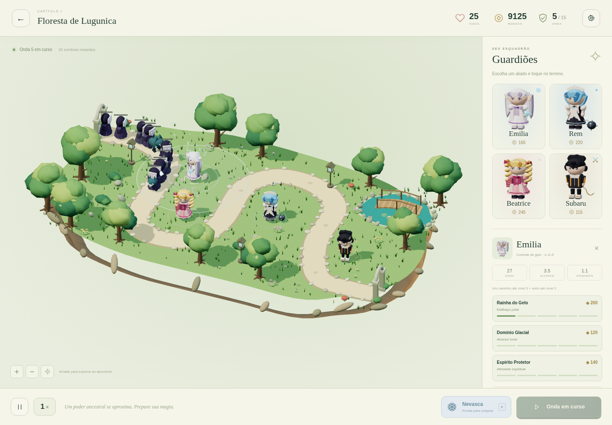
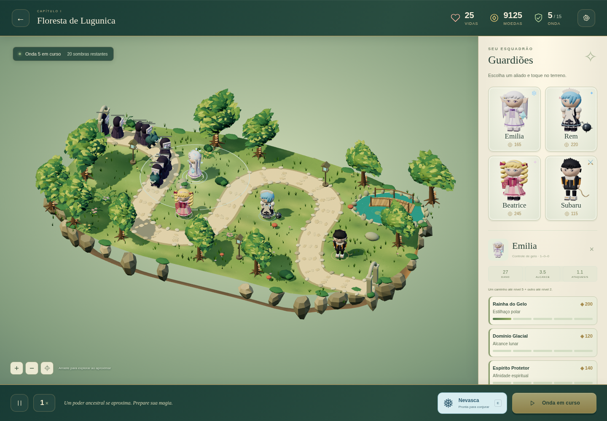
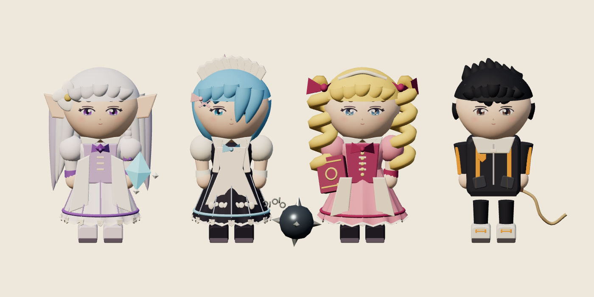
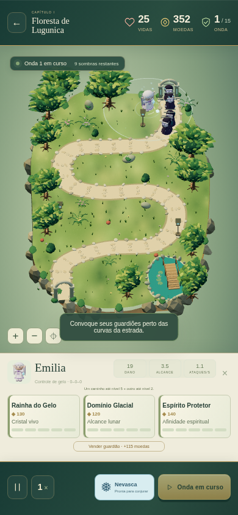

# Etapa 1 — revisão da arte e dos controles

Esta revisão parte de `3c3ae91`, que já continha quatro guardiões, três mapas, combate, evoluções e salvamento. A análise de `index.html`, `astral3d.js`, `astral3d.css` e dos módulos em `src/` confirmou que essa base podia ser preservada. A validação inicial passou nos 7 testes de regras e nos 12 resultados da suíte de navegador já existente.

## Alterações desta revisão

- **Vegetação:** copas com contorno irregular e folhas tridimensionais dobradas, distribuídas por instanciamento. Galhos, raízes, fungos de tronco e samambaias substituem o aspecto de copas lisas. Materiais compartilhados permitem agrupar a geometria estática.
- **Terreno:** textura original pintada por código, com manchas amplas de cor, musgo, pedras do caminho e fragmentos rochosos com faces irregulares. Os terrenos úteis e o traçado das três rotas foram preservados.
- **Quatro guardiões:** mechas com volume contínuo e pontas afiladas; costuras, rendas e adornos; corpete modelado; elos individuais na corrente de Rem; presilhas e pupilas próprias; detalhes do agasalho de Subaru. Animações de conjuração, leitura, chicote e golpe pesado têm poses distintas.
- **Inspeção dos modelos:** o menu dos guardiões agora abre um visor 3D animado. Arraste ou use os botões de giro; “Ver ataque” demonstra a animação. Fechar o diálogo descarta o renderer e seu contexto. Um retrato serve de alternativa se outro contexto WebGL não puder ser aberto.
- **Posicionamento:** prévia translúcida do personagem, círculo com validade do terreno e cancelamento que descarta seus materiais temporários. Arrastos superiores ao limite de toque não compram unidades. Cabeça, corpo e equipamentos aceitam seleção por raycasting.
- **Renderização:** diálogos interrompem o desenho do mundo encoberto; mudar a qualidade reconstrói a densidade da vegetação e libera os recursos do mundo anterior. A simulação, o orçamento e os preços não foram alterados.
- **Câmera móvel:** o eixo longo do campo acompanha a altura da tela em retrato. O enquadramento considera os limites do mundo; zoom, arraste e centralização usam a orientação atual.
- **HUD:** molduras em verde profundo e latão, cartas em pergaminho, contadores com maior contraste e textos de evolução maiores.

## Escopo e limites

A revisão mantém os quatro personagens e os três capítulos já existentes. Não implementa os quatro personagens adicionais, os cinco mapas restantes ou as habilidades individuais das etapas posteriores. A arte é procedural original, com malhas detalhadas e articuladas; ainda exige produção artística adicional para atingir a referência comercial solicitada. As capturas são do jogo executado, sem tratamento de imagem.

O desempenho e os controles móveis foram verificados em Chromium com renderização por software e telas emuladas. Isso não certifica FPS em celulares físicos, Safari ou iOS. O ensaio de economia desativa a renderização durante a simulação e não é um benchmark gráfico.

O build permanece estático, com Three.js local e caminhos relativos compatíveis com GitHub Pages. Esta revisão é entregue em uma branch para revisão; o endereço público existente só muda depois de uma integração e publicação.

## Comparação desta revisão

As duas partidas abaixo usam os mesmos quatro guardiões, o mesmo orçamento de preparação de QA, a mesma evolução e a mesma onda. O orçamento aumentado serve somente à captura; o teste de economia utiliza as 500 moedas reais.

| Base de `3c3ae91` | Revisão atual |
| --- | --- |
|  |  |

