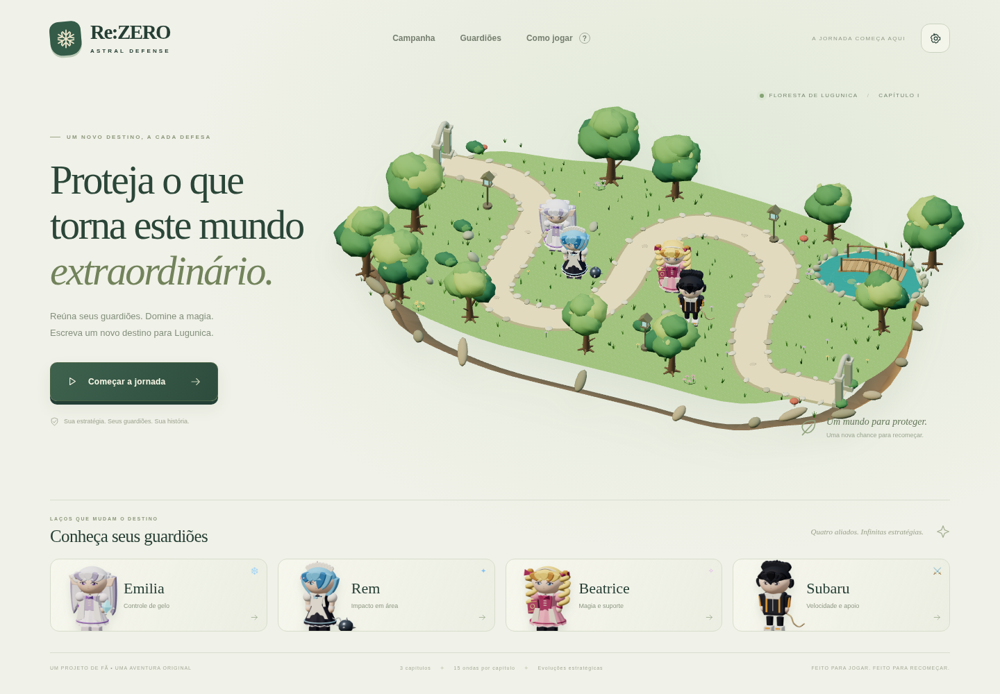
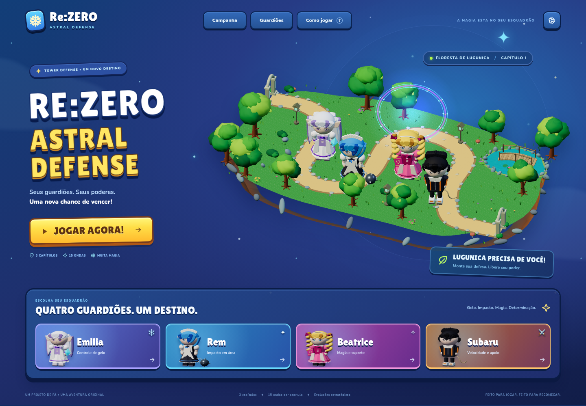
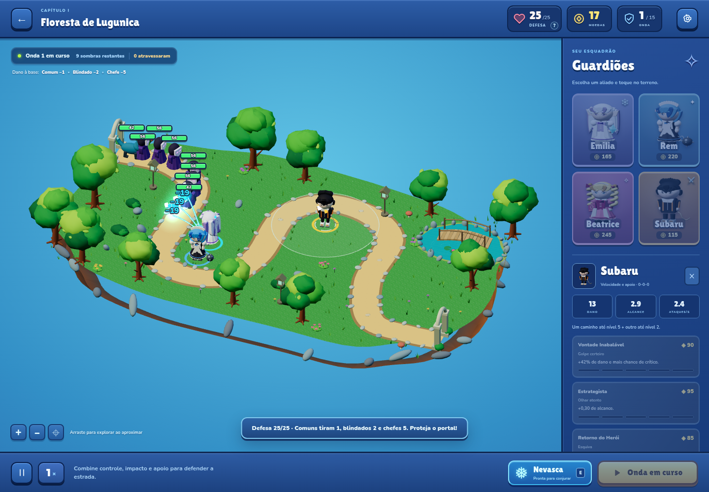
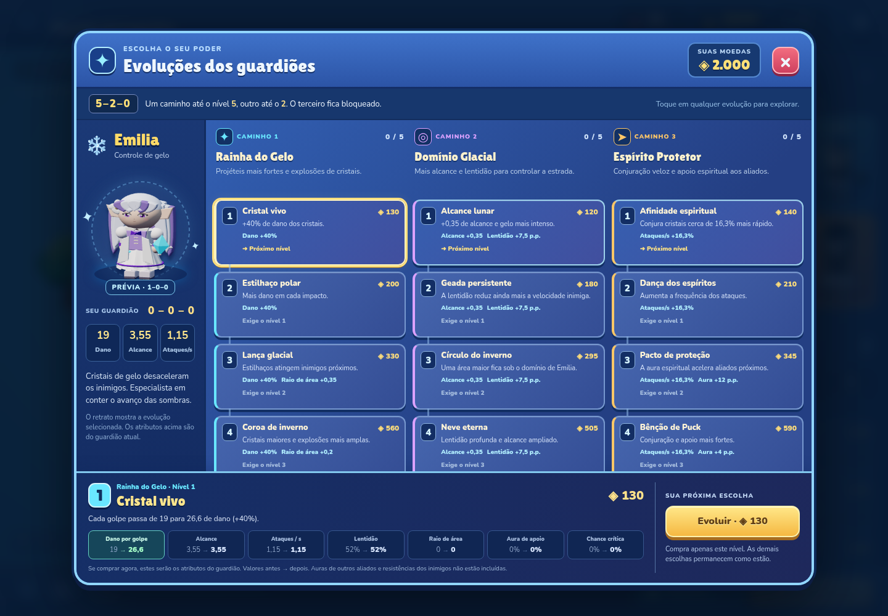
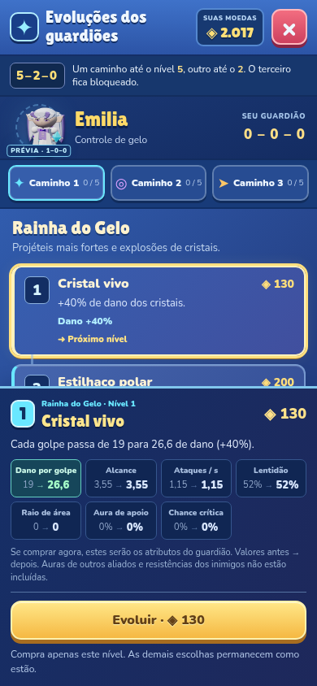
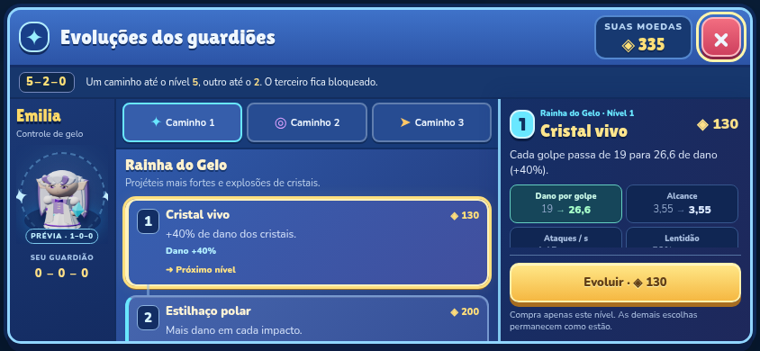

# Interface, combate e evoluções — versão 2.1

Esta revisão resolve a falta de leitura das vidas e ataques, explica a condição de derrota e reconstrói a apresentação com cores vivas e animação. Não usa arte, interface ou áudio extraídos de Bloons TD 6.

## Vidas e ataques visíveis

As barras anteriores misturavam preenchimento opaco e fundo transparente sem teste de profundidade. O fundo era desenhado depois e apagava a cor. No celular, a geometria também ocupava aproximadamente 11 × 0,9 pixels.

As barras agora são desenhadas sobre o cenário, acima da cabeça do modelo, com tamanho constante na tela:

| Tipo | Desktop | Celular |
| --- | --- | --- |
| Inimigo comum | 54 × 13 px | 44 × 12 px |
| Chefe | 84 × 16 px | 84 × 16 px |

Elas mostram HP numérico, preenchimento proporcional, cores de alerta e não diminuem ao afastar a câmera. Números de dano usam um pool limitado e desaparecem em tempo visual.

Os quatro guardiões têm gestos próprios, origem do disparo na mão/arma, projéteis distintos, trilhas, clarão e reação ao impacto. A trilha dura 0,3 segundo visual, inclusive em 3×. A animação de ataque também usa tempo visual; a simulação de dano continua com passos fixos de 1/60 s.

## Quantos inimigos podem atravessar

A base começa com 25 pontos de defesa. A derrota acontece quando ela chega a zero.

| Inimigo | Dano à base | Quantos encerram uma base com 25 pontos |
| --- | --- | --- |
| Sombras, velozes e espectros | 1 | 25 |
| Blindados | 2 | 13 |
| Chefes | 5 | 5 |

As quantidades da última coluna consideram apenas aquele tipo. Em grupos mistos, os danos se somam. O HUD mostra **DEFESA 25/25**, inimigos que **atravessaram** e os danos de cada categoria. Tocar no indicador de defesa abre a explicação com as quantidades recalculadas para a defesa atual. Cada vazamento também mostra a perda e o saldo. A derrota informa quantos atravessaram e o dano total.

## Tela completa de evolução

Na batalha, selecione um guardião e use **Ver todas as evoluções**. No menu, abra um guardião e escolha a mesma opção para consultar o catálogo.

- Três caminhos com cinco níveis cada: nome, preço, descrição, efeitos e requisitos.
- Comparação de sete atributos calculada pelas próprias regras do combate: dano, alcance, ataques por segundo, lentidão, raio de área, aura de apoio e chance crítica.
- Retrato da evolução selecionada, prévia de combinações legais, níveis adquiridos e motivos de bloqueio.
- Compra de um nível por vez, com atualização de moedas e atributos. O catálogo permite planejar sem comprar.
- Regra 5–2–0 preservada: um caminho até 5, outro até 2, terceiro bloqueado.
- Batalha e recarga pausam durante a consulta. Em celular, três abas e rolagem por toque permitem chegar ao quinto nível de cada caminho.
- Na horizontal, a lista de níveis e o painel de efeitos/compra ficam lado a lado. A checagem de 844 × 390 detectou que o layout anterior reduzia a lista a altura zero; a regra de telas baixas agora mantém 268 px para a área principal e o botão de compra inteiro na tela. A regressão percorre os três caminhos e compra uma evolução nessa orientação.

## Design e distribuição

A interface foi reconstruída com azul, violeta, ciano e ouro, tipografia arredondada local, botões grandes, cards coloridos e um menu com portal e personagens animados. Os três mundos e os modelos receberam cores mais vivas.

Nunito e Lilita One são distribuídas localmente, com suas licenças OFL em `vendor/fonts/`. A página, os módulos e a folha de evolução usam a versão `2.1.0` nas URLs para evitar misturar módulos antigos e novos depois de atualizar o GitHub Pages. O build estático mantém caminhos relativos e não exige recursos externos.

## Validação

```sh
npm test
npm run build
npm ci
npx playwright install chromium
npm run test:browser
```

`test:browser` executa as duas suítes em sequência para evitar competição entre navegadores. A suíte anterior passou com 12/12 resultados; a nova suíte de legibilidade passou com 9/9, sem erros de console ou JavaScript. Os sete testes de regras também passaram.

A regressão nova verifica dimensões reais das barras, HP/fill após dano, cores de alerta, zoom, chefes, ataques dos quatro personagens em 1×/3×, tempo visual das trilhas, impacto real, defesa e contador, 15 níveis por guardião, quatro catálogos, compra, bloqueios, pausa e navegação por toque até o quinto nível. Os contextos móveis usam 390 × 844 e 844 × 390.

O build servido em `/dist/` também foi aberto com todas as requisições externas bloqueadas: nenhuma requisição externa, erro de console ou exceção. Os alvos de toque medidos foram 76 × 46 px para a ajuda de defesa e 368 × 44 px para abrir as evoluções.

Uma simulação separada de 15 ondas com as 500 moedas iniciais e somente recompensas reais voltou a vencer: 25 pontos de defesa, 398 eliminações e 1.840 moedas finais. Esse ensaio desativa a renderização para acelerar o cálculo; ele não mede FPS. As telas móveis são emuladas, e aparelhos físicos ainda não foram medidos.

## Capturas reais

| Menu anterior | Novo menu |
| --- | --- |
|  |  |










As imagens são capturas do navegador sem edição. Algumas usam uma preparação de QA para mostrar um chefe, o painel de compras ou um nível específico; os testes de economia normal são executados separadamente.
