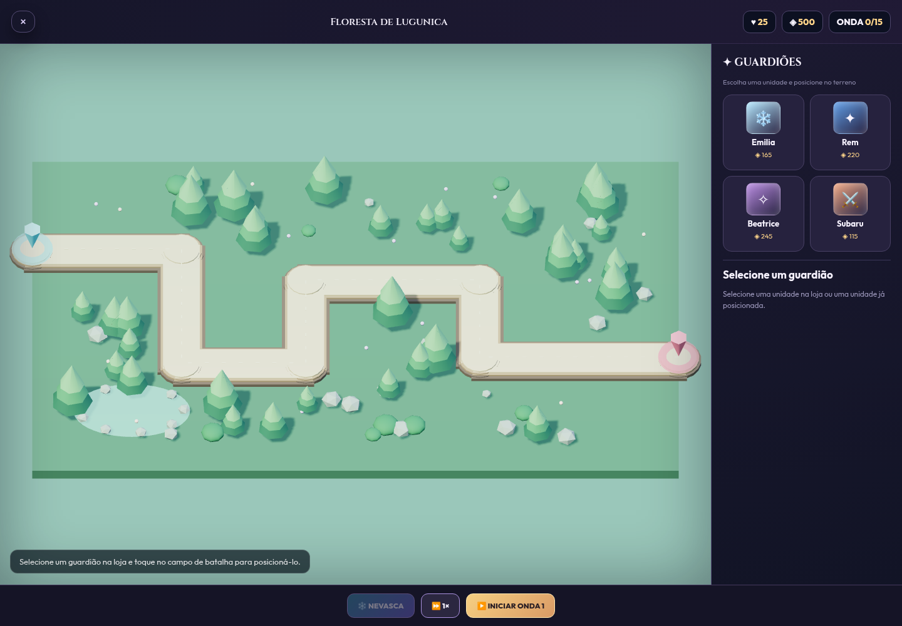
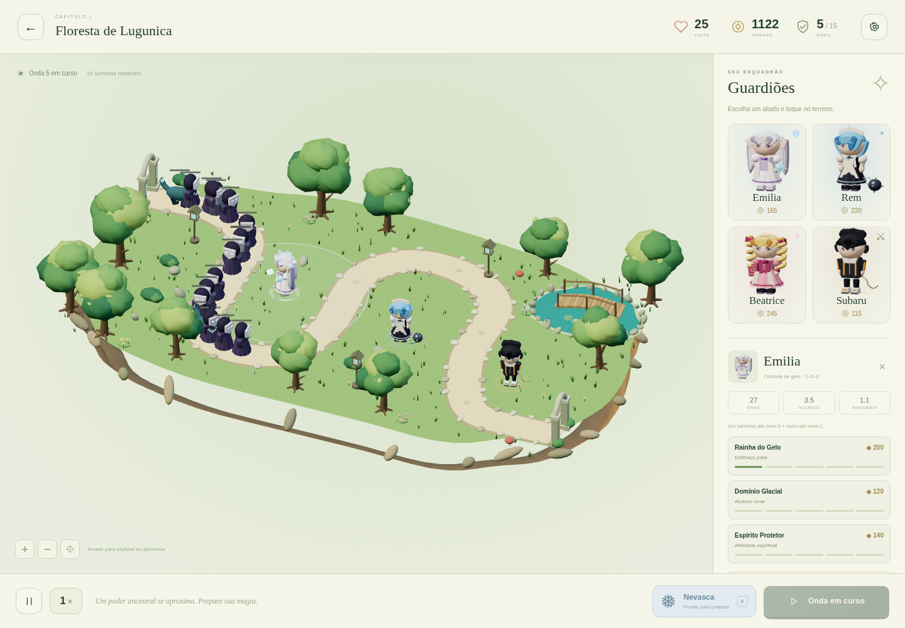
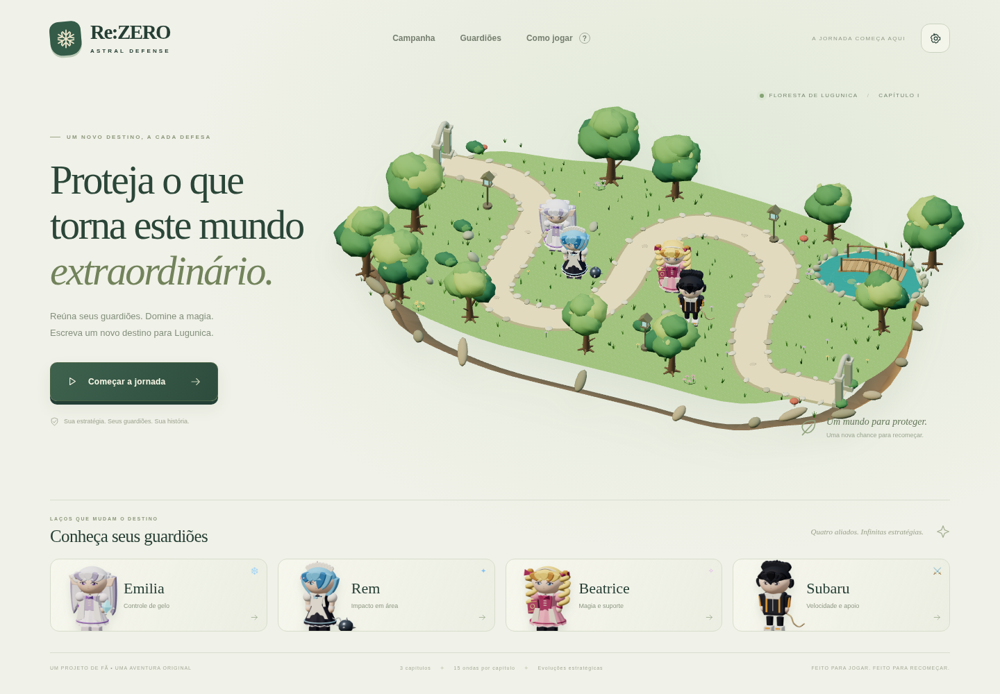
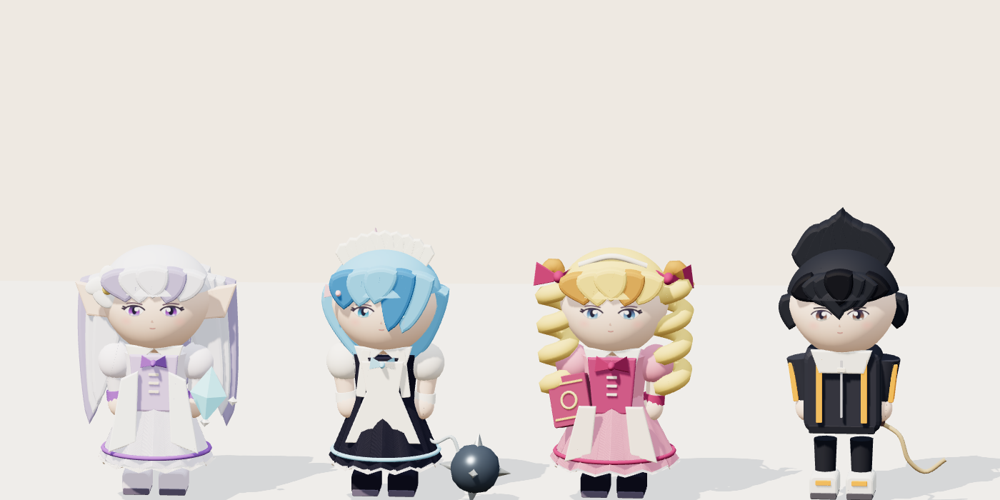
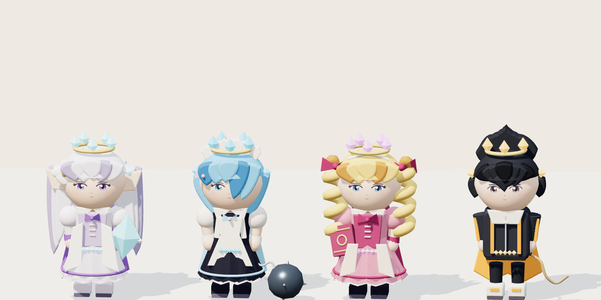
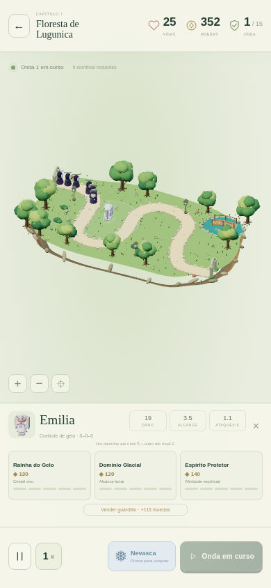

# Validação da Etapa 1

## Reproduzir

```sh
npm test
npm run build
npm ci
npx playwright install chromium
npm run test:browser
```

A suíte de navegador cria seu próprio servidor temporário e encerra servidor e Chromium ao terminar. Opcionalmente use `BROWSER_URL` para testar um servidor existente, `CHROMIUM_PATH` para selecionar o navegador, `PLAYWRIGHT_MODULE` para o módulo instalado em outro local e `QA_OUTPUT` para escolher o diretório das capturas. Sem `QA_OUTPUT`, as capturas ficam no diretório temporário do sistema, em `rezero-defense-qa`.

Os cenários de integração acessam `?test=1`, que expõe uma API de QA. O jogo normal não expõe essa API. Os testes de vitória e evoluções máximas usam moedas de preparação para exercitar todos os caminhos; não representam uma medição de dificuldade de uma partida comum.

Última execução: **7/7 testes de domínio e 12/12 resultados da suíte de navegador passaram**, sem falhas, testes ignorados, erros de console ou exceções. O resultado do navegador inclui 11 cenários e o contêiner da suíte. Data: 13/11/2026.

## O que foi executado

- Sete testes de domínio: três caminhos de cinco níveis por guardião, combinações 5–2–0, consequências nos atributos, ondas e chefes, corrupção/migração do salvamento e movimento por distância.
- Integração em Chromium: menu, tutorial, prévias de personagens, configurações, bloqueio de capítulos, compras por clique/toque, rejeição de terreno e sobreposição sem débito, evolução, apoio de Beatrice, combate, recompensas e conclusão de ondas.
- Nevasca: exige Emilia, respeita recarga em tempo de jogo, mantém seu efeito de lentidão quando Emilia ataca e não avança durante pausa.
- Chefes e encerramento: barras com valores finitos, derrota por vazamento, vitória de 15 ondas por combate, desbloqueio e persistência após recarregar.
- Mapas: os três mundos foram abertos. Aproximadamente 44–48% dos pontos da grade de terreno amostrada aceitam posicionamento, depois das exclusões de estrada, água e obstáculos.
- Celular emulado: 390 × 844 em retrato e 844 × 390 em paisagem; toque, evolução, zoom, arraste e centralização, sem transbordamento horizontal.
- Build estático servido em `/dist/`: carregou, iniciou combate e produziu capturas sem erros de JavaScript e sem qualquer requisição de recursos externos. Os caminhos relativos funcionam sob subdiretório.
- `git diff --check`, checagem sintática e build estático concluídos.

## Viabilidade da economia

Para reproduzir esse ensaio, deixe `npm run dev` ativo em outro terminal e execute `npm run test:balance`. Ele também aceita `BROWSER_URL`, `PLAYWRIGHT_MODULE` e `CHROMIUM_PATH`.

Uma simulação separada venceu as 15 ondas da Floresta com o orçamento inicial real de 500 moedas, sem alterar moedas, vidas ou HP. Emilia, Rem e Subaru consumiram as 500 moedas iniciais; Beatrice e as evoluções foram compradas somente com recompensas. A estratégia usou cobertura de curvas e Nevasca. Resultado: 25 vidas, 398 eliminações, 1.840 moedas finais e capítulo II desbloqueado, em 515 segundos simulados. A renderização foi desativada durante esse ensaio para acelerar o cálculo; ele verifica viabilidade econômica e estratégica, não FPS nem a experiência de um iniciante.

## Correções verificadas

| Problema anterior | Comportamento atual |
| --- | --- |
| Barras acessavam `e.max`, inexistente | Usam `maxHp` e permanecem finitas |
| Beatrice era comparada com a chave `bea` | Modelo próprio com vestido, cachos, laços e livro |
| Diálogos deixavam a batalha continuar | Simulação e recargas pausam em diálogos e abas ocultas |
| Lentidão usava relógio real | Efeitos e recargas seguem o tempo da simulação |
| Cadência perdia tempo em 2×/3× | Passos fixos de 1/60 s e preservação do saldo da recarga |
| Cristal normal substituía Nevasca | Efeitos têm durações independentes |
| Projéteis podiam ficar suspensos entre ondas | São retirados e descartados ao encerrar a onda |
| Áudio de ataques ficava mudo ao reiniciar | Relógio de limitação reinicia com a partida |
| Salvamento parcial podia quebrar a campanha | Validação, limites e migração do formato anterior |
| Recursos GPU eram abandonados ao trocar mapas | Descarte do mundo e projéteis; cache compartilhado dos modelos |
| Three.js dependia de CDN | Distribuição local com licença MIT |

## Capturas reais

| Antes | Depois |
| --- | --- |
|  |  |









As capturas foram feitas no navegador, sem edição. A cena de batalha da comparação usa uma preparação de QA para mostrar os modelos, as evoluções e o combate.

## Limites desta validação

O navegador de QA usa Chromium com SwiftShader, renderização por software. As telas móveis são emuladas; não houve medição em celular físico intermediário, Safari/iOS ou GPU móvel real. Portanto, não se afirma uma taxa de quadros garantida nesses aparelhos.

A Etapa 1 está implementada como base jogável e visual reconstruída. Oito personagens, oito mapas, conquistas, conta/sincronização e habilidades individuais completas continuam como escopo das etapas seguintes. Os modelos são arte procedural original, com detalhes e articulações; não são modelos oficiais ou uma produção AAA.
